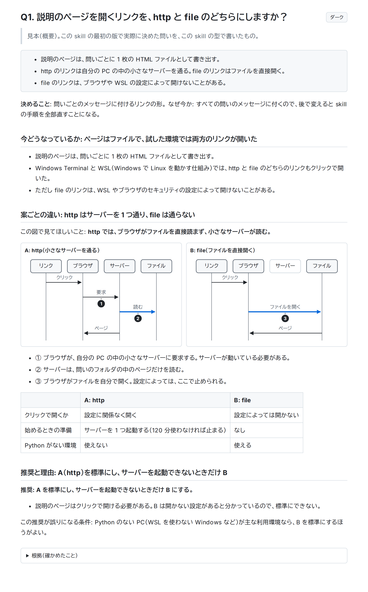

# show-and-grill

Language: [English](README.md) | 日本語

> 英語の [README.md](README.md) が正本です。この日本語版は訳で、更新が遅れることがあります。違いがあるときは英語版に従ってください。

コーディングエージェント（Claude Code と Codex）のための、妥協しない設計のインタビューです。

問いのたびに、エージェントが決めるのに要る事実を 1 枚のページに書きます。今どうなっているか、案ごとにどう違うか、推奨は何かを、図と表で示します。ページはターミナルのリンクから開き、答えはターミナルで 1 問ずつ返します。最後に、決めたことが Issue の本文（または計画のファイル）と、経緯を残すコメントに入ります。

Issue や計画を書いた直後、自動の作業を始める前に、自分の意思で起動して使います。小さな Issue には使いません。

<picture>
  <source media="(prefers-color-scheme: dark)" srcset="docs/images/example-ja-dark.png">
  
</picture>

問いのページの例です（[`example-ja.html`](skills/show-and-grill/example-ja.html)。英語版は [`example-en.html`](skills/show-and-grill/example-en.html)）。ターミナルには、問い・選択肢・推奨・リンクだけが出ます。

```text
**Q3. カテゴリごとの過去の成績を、どこに出しますか？**
- A: 一覧の上に要約を出す
- B: カテゴリの見出しに入れる
- C: 出さない
推奨: A — 一覧を読む前に、そのカテゴリが何を意味するかが分かる
説明: http://127.0.0.1:8765/q03.html
```

## なぜ show-and-grill か

作業の前に自分をインタビューすると、後で戻すのが高くつく判断を早く拾えます。ただ、ターミナルだけのインタビューでは、問いの裏にある事実をチャットのメッセージに収めるしかありません。show-and-grill は、その事実をページに移し、ターミナルは答えるためだけに使います。

| | ターミナルだけのインタビュー | show-and-grill |
|---|---|---|
| 判断に要る事実 | 問いの文の中に混ざる | 問いごとに 1 枚のページ：今どうなっているか、案、推奨 |
| 案の比べ方 | 文章 | 図（シーケンス、画面の配置、変更の前後）と表 |
| ターミナル | スクロールの要る長いメッセージ | 問い・選択肢・推奨・リンクだけ |
| 決めたことの行き先 | 自分で写した先 | Issue の本文と、問いと答えを 1 つずつ残す経緯のコメント |

GUI ではありません。ページは静的な HTML のファイルで、手元の小さなサーバはファイルを配るだけです。ブラウザが無い環境（SSH、devcontainer）では、`cui` を付ければすべてターミナルで進みます。

## 動き方

1. Issue か計画を指定して起動します。Claude Code では `/show-and-grill 123`、Codex では `$show-and-grill 123`。勝手には起動しません。
2. エージェントが対象とコードを読み、後で戻しにくい判断を洗い出します。コードで分かる事実は、人に聞かずに自分で調べます。小さな Issue は飛ばします。
3. 問いごとに 1 枚のページを書き、そのフォルダを `127.0.0.1` で配ります。サーバは使われなくなると自分で止まります。
4. ターミナルで答えます。`A`、`yes`、`Q2 に戻る`、ページを詳しく書き直させる `more detail` などです。
5. 決めたことは Issue の本文に入り、`## show-and-grill provenance` のコメントに問いと答えが 1 つずつ残ります。`gh` が無いときは、貼り付け用の Markdown のファイルを書きます。ローカルの計画では、選んだほうに従って、計画に追記するか新しいファイルに書きます。途中でやめても進み具合を保存するので、続きから再開できます。

```text
/show-and-grill 123                 # Claude Code: Issue 123 を grill する
/show-and-grill docs/plan.md cui    # ローカルの計画を、すべてターミナルで
$show-and-grill 123 detail ja       # Codex: 詳しいページを日本語で
```

動きの詳細は [skills/show-and-grill/SKILL.md](skills/show-and-grill/SKILL.md)（英語）にあります。版ごとの変更は [CHANGELOG.md](CHANGELOG.md) にあります。

## 入れ方

**エージェントごとに 1 つの方法を選んでください。** 同じ skill を 2 つの方法で入れると（たとえば plugin と `install.sh`、またはリポジトリと利用者の全体の両方）、エージェントがどちらのコピーを読むか決まらなかったり、一覧に 2 回出たりします。

### 1. plugin

Claude Code（skill の名前は `/show-and-grill:show-and-grill` になります）:

```bash
claude plugin marketplace add apokamo/show-and-grill
claude plugin install show-and-grill@show-and-grill
```

Codex:

```bash
codex plugin marketplace add apokamo/show-and-grill
```

そのあと、Codex の `/plugins` から `show-and-grill` を入れます。

### 2. `npx skills add`

```bash
npx skills add apokamo/show-and-grill
```

`skills/show-and-grill/` を見つけて、エージェントが読むフォルダにコピーします。

### 3. `install.sh`

macOS と Linux（WSL を含む）で使えます。`git` が要ります。

今いる git リポジトリに入れる（`.claude/skills/show-and-grill/` と、Codex 用に `.agents/skills/show-and-grill` のリンク）:

```bash
curl -fsSL https://raw.githubusercontent.com/apokamo/show-and-grill/main/install.sh | sh -s -- --version v0.1.0
```

利用者の全体に、`$HOME` の下に入れる（`~/.claude/skills/` と `~/.agents/skills/`）:

```bash
curl -fsSL https://raw.githubusercontent.com/apokamo/show-and-grill/main/install.sh | sh -s -- --user --version v0.1.0
```

| オプション | 意味 |
|---|---|
| `--user` | 今いる git リポジトリではなく、`$HOME` の下に入れる |
| `--version vX.Y.Z` | 入れるタグ。省くと、いちばん新しい `vX.Y.Z` のタグ |
| `--from <dir>` | ダウンロードせず、このリポジトリの手元のコピーから入れる |

更新するときは、もう一度実行します。同じ名前のコピーとリンクを置き換えます。失敗したときは、古いコピーがそのまま残ります。もう一方の場所（リポジトリと利用者の全体）にも入っているときは、警告を出したうえで入れます。

### WSL を使わない Windows

フォルダを手でコピーします。PowerShell で、このリポジトリを手元に取ってきたフォルダから:

```powershell
# Claude Code、利用者の全体に
New-Item -ItemType Directory -Force "$HOME\.claude\skills" | Out-Null
Copy-Item -Recurse -Force skills\show-and-grill "$HOME\.claude\skills\"

# Codex、利用者の全体に
New-Item -ItemType Directory -Force "$HOME\.agents\skills" | Out-Null
Copy-Item -Recurse -Force skills\show-and-grill "$HOME\.agents\skills\"
```

1 つのリポジトリにだけ入れるときは、`<リポジトリ>\.claude\skills` と `<リポジトリ>\.agents\skills` を使います。更新するときは、先に古い `show-and-grill` のフォルダを消してから、もう一度コピーします。

ページのサーバは、Python があれば Python で動きます。Python が無いときは `scripts/serve.ps1`（Windows PowerShell 5.1 または PowerShell 7）を使います。

## 必要なもの

- skill を読むコーディングエージェント：Claude Code または Codex。
- ページのサーバ用に、Python 3（`python3`、`python`、`py -3` のどれか）、または Windows の PowerShell。
- 決めたことを Issue に書くための `gh`（GitHub CLI）。無いときは、貼り付け用の Markdown のファイルを書きます。
- ページは marked、DOMPurify、Web フォントを CDN から読み込みます。オフラインでは、Markdown をそのまま表示します。

## 開発

テストの実行（Python 3.12 以上）:

```bash
python -m pip install pytest pyyaml
python -m pytest
```

`serve.ps1` のテストは、`pwsh`（Windows では `powershell` も）が見つかれば動き、無ければ skip します。`SHOW_AND_GRILL_REQUIRE_PWSH=1` を付けると、見つからない PowerShell があるたびに skip ではなく失敗にします（Windows では `powershell` と `pwsh` の両方が要ります。CI はこれを付けています）。`install.sh` のテストは Windows では動きません。

## 出典

新しく書いた実装です。コードは写しておらず、考え方だけを借りました。主な出典:

- [mattpocock/skills](https://github.com/mattpocock/skills)（MIT）：grill の考え方と、その中心の規則。
- [nicobailon/visual-explainer](https://github.com/nicobailon/visual-explainer)（MIT）：平易な言葉と、図の部品。
- [jasonku09/grill-with-ui](https://github.com/jasonku09/grill-with-ui)（MIT）：問いの横に推奨を出すこと。

すべての出典は [SKILL.md](skills/show-and-grill/SKILL.md) の "Sources and credits" にあります。

## ライセンス

[MIT](LICENSE)
