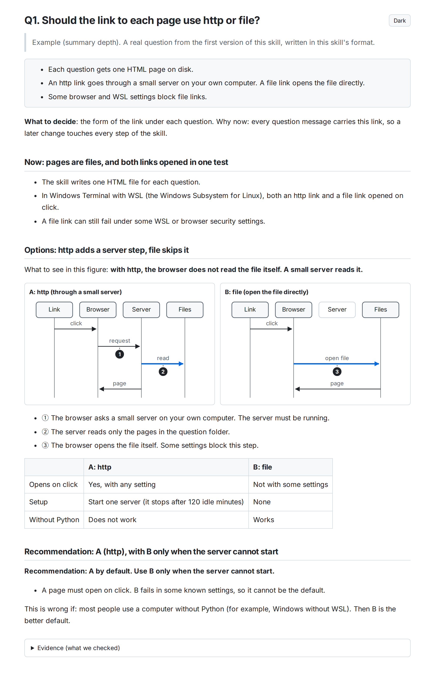

# show-and-grill

Language: English | [日本語](README.ja.md)

A relentless design interview for coding agents (Claude Code and Codex).

Before each question, the agent writes a page with the facts you need to decide: how things work now, how the options differ, and a recommendation, with figures and tables. You open the page from a link in the terminal and answer in the terminal, one question at a time. At the end, the decisions go into the issue body (or your plan file) and a provenance comment.

Use it on purpose, right after an issue or plan is written and before automated work starts. Skip it for small issues.

<picture>
  <source media="(prefers-color-scheme: dark)" srcset="docs/images/example-dark.png">
  
</picture>

One question page ([`example-en.html`](skills/show-and-grill/example-en.html); also in [Japanese](skills/show-and-grill/example-ja.html)). The terminal shows only the question, the options, the recommendation, and the link:

```text
**Q3. Where should the past results of each category appear?**
- A: A summary above the list
- B: In the category heading
- C: Do not show them
Recommendation: A — readers see what the category means before reading the list
Explanation: http://127.0.0.1:8765/q03.html
```

## Why show-and-grill

Interviewing yourself before work starts catches the decisions that are costly to undo. In a terminal-only interview, though, the facts behind each question have to fit in a chat message. show-and-grill moves those facts to a page and keeps the terminal for answering.

| | Interview in the terminal only | show-and-grill |
|---|---|---|
| Facts for a decision | Mixed into the question text | One page per question: how it works now, the options, a recommendation |
| Comparing options | Prose | Figures (sequences, layouts, before and after) and a table |
| The terminal | Long messages to scroll | The question, the options, the recommendation, and a link |
| Where the decisions go | Wherever you copy them | The issue body, plus a provenance comment with each question and answer |

It is not a GUI. Each page is a static HTML file, and a tiny local server only serves the files. With no browser (SSH, a devcontainer), `cui` keeps everything in the terminal.

## How it works

1. You start it on an issue or a plan: `/show-and-grill 123` in Claude Code, `$show-and-grill 123` in Codex. It never starts on its own.
2. The agent reads the target and the code, and lists the decisions that are hard to undo. It looks up facts in the code instead of asking you. A small issue is skipped.
3. For each question, it writes one page and serves the folder on `127.0.0.1`. The server stops by itself when unused.
4. You answer in the terminal: `A`, `yes`, `back to Q2`, or `more detail` to rewrite the page at more depth.
5. The decisions go into the issue body, and a `## show-and-grill provenance` comment records each question and answer. Without `gh`, it writes a Markdown file for you to paste. For a local plan, it appends to the plan or writes a new file, as you choose. If you stop early, it saves the progress so you can resume.

```text
/show-and-grill 123                 # Claude Code: grill issue 123
/show-and-grill docs/plan.md cui    # a local plan, everything in the terminal
$show-and-grill 123 detail ja       # Codex: longer pages, in Japanese
```

See [skills/show-and-grill/SKILL.md](skills/show-and-grill/SKILL.md) for the full behavior. Changes between versions are in [CHANGELOG.md](CHANGELOG.md).

## Install

**Pick one way per agent.** If you install the same skill two ways (for example, the plugin and `install.sh`, or in a repository and for the user), the agent can load either copy or list the skill twice.

### 1. Plugin

Claude Code (the skill is then called `/show-and-grill:show-and-grill`):

```bash
claude plugin marketplace add apokamo/show-and-grill
claude plugin install show-and-grill@show-and-grill
```

Codex:

```bash
codex plugin marketplace add apokamo/show-and-grill
```

Then install `show-and-grill` from `/plugins` in Codex.

### 2. `npx skills add`

```bash
npx skills add apokamo/show-and-grill
```

It finds `skills/show-and-grill/` and copies it to the folders your agents read.

### 3. `install.sh`

macOS and Linux (including WSL). It needs `git`.

Install into the current git repository (`.claude/skills/show-and-grill/`, plus a link at `.agents/skills/show-and-grill` for Codex):

```bash
curl -fsSL https://raw.githubusercontent.com/apokamo/show-and-grill/main/install.sh | sh -s -- --version v0.1.0
```

Install for the user, under `$HOME` (`~/.claude/skills/` and `~/.agents/skills/`):

```bash
curl -fsSL https://raw.githubusercontent.com/apokamo/show-and-grill/main/install.sh | sh -s -- --user --version v0.1.0
```

| Option | Meaning |
|---|---|
| `--user` | Install under `$HOME` instead of the current git repository |
| `--version vX.Y.Z` | The tag to install. Default: the latest `vX.Y.Z` tag |
| `--from <dir>` | Copy from a local checkout of this repository instead of downloading |

Run it again to update: it replaces the copy and the link with the same name. If it fails, the old copy stays as it was. If the skill is also installed in the other place (in the repository and for the user), it prints a warning and still installs.

### Windows without WSL

Copy the folder by hand. In PowerShell, from a checkout of this repository:

```powershell
# Claude Code, for the user
New-Item -ItemType Directory -Force "$HOME\.claude\skills" | Out-Null
Copy-Item -Recurse -Force skills\show-and-grill "$HOME\.claude\skills\"

# Codex, for the user
New-Item -ItemType Directory -Force "$HOME\.agents\skills" | Out-Null
Copy-Item -Recurse -Force skills\show-and-grill "$HOME\.agents\skills\"
```

To install into one repository instead, use `<repository>\.claude\skills` and `<repository>\.agents\skills`. To update, delete the old `show-and-grill` folder first, then copy again.

The page server uses Python when it is installed. Without Python, the skill uses `scripts/serve.ps1` (Windows PowerShell 5.1 or PowerShell 7).

## Requirements

- A coding agent that reads skills: Claude Code or Codex.
- For the page server: Python 3 (`python3`, `python`, or `py -3`), or PowerShell on Windows.
- `gh` (GitHub CLI) to write decisions into an issue. Without it, the skill writes a Markdown file for you to paste.
- The pages load marked, DOMPurify, and web fonts from a CDN. Offline, the page shows the raw Markdown.

## Development

Run the tests (Python 3.12 or later):

```bash
python -m pip install pytest pyyaml
python -m pytest
```

The `serve.ps1` tests run when `pwsh` (or, on Windows, `powershell`) is found, and are skipped otherwise. Set `SHOW_AND_GRILL_REQUIRE_PWSH=1` to make each missing PowerShell fail instead (on Windows, both `powershell` and `pwsh` are then required; the CI does this). The `install.sh` tests do not run on Windows.

## Credits

This is a new implementation. No code was copied; only ideas were taken. The main sources:

- [mattpocock/skills](https://github.com/mattpocock/skills) (MIT): the grilling idea and its core rules.
- [nicobailon/visual-explainer](https://github.com/nicobailon/visual-explainer) (MIT): plain language and the figure parts.
- [jasonku09/grill-with-ui](https://github.com/jasonku09/grill-with-ui) (MIT): showing a recommendation next to each question.

See "Sources and credits" in [SKILL.md](skills/show-and-grill/SKILL.md) for the full list.

## License

[MIT](LICENSE)
